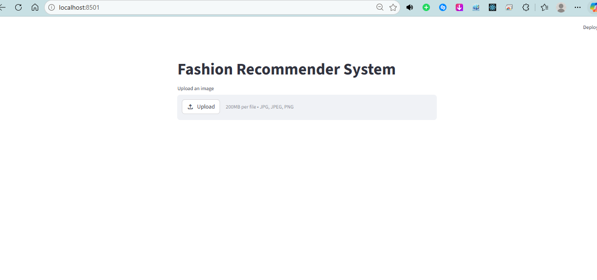
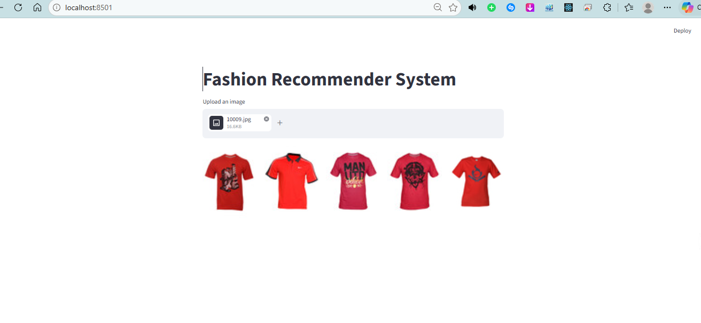

# Fashion Recommender

A Streamlit app that recommends visually similar fashion products from an uploaded image. It uses an ImageNet-pretrained ResNet50 to extract image features and a scikit-learn nearest-neighbor index to retrieve five similar catalog images.

## Preview





## How it works

1. Upload a JPG, JPEG, or PNG image.
2. The app converts it to RGB, resizes it to 224 x 224 pixels, and applies ResNet50 preprocessing.
3. ResNet50 with global average pooling produces an image embedding.
4. The saved nearest-neighbor index finds five catalog images using Euclidean distance.
5. Streamlit displays the matching images side by side.

Recommendations depend on visual similarity and the available catalog. The app does not use user profiles, purchase history, or product availability.

## Project structure

```text
FashionRecommender/
|-- README.md
|-- requirements.txt
|-- DeploymentImages/          # Screenshots
|-- data/
|   |-- images/               # Catalog images used by the notebooks and app
|   `-- styles.csv            # Metadata used by main.ipynb
`-- frontend/
    |-- app.py               # Streamlit interface
    |-- main2.ipynb          # Builds the artifacts used by the app
    |-- main.ipynb           # Separate classification experiment
    |-- fashionModel.keras  # Saved feature extractor (generated)
    |-- knn_model.pkl        # Fitted nearest-neighbor index (generated)
    |-- image_paths.json     # Ordered catalog paths (generated)
    |-- embeddings.npy       # Saved catalog embeddings (generated)
    `-- test.jpg             # Sample image for notebook experiments
```

## Setup

The local project uses Python 3.13. Dependency versions in `requirements.txt` were recorded from the local environment; a fresh installation has not been verified.

From the `FashionRecommender` directory, create a virtual environment:

```bash
python -m venv .venv
```

Activate it on Windows PowerShell:

```powershell
.\.venv\Scripts\Activate.ps1
```

Or on macOS/Linux:

```bash
source .venv/bin/activate
```

Install the dependencies:

```bash
python -m pip install -r requirements.txt
```

### Required data and model files

Before starting the app, place the catalog images in `data/images/` and ensure these files exist in `frontend/`:

| File | Purpose |
| --- | --- |
| `fashionModel.keras` | ResNet50 feature extractor |
| `knn_model.pkl` | Nearest-neighbor index fitted to the catalog embeddings |
| `image_paths.json` | Image paths in the same order as the indexed embeddings |

The app needs the actual catalog images to display recommendations. `embeddings.npy` and `styles.csv` are not loaded by the app.

If the dataset or generated artifacts are absent from your clone, supply the catalog images and generate the artifacts using the notebook instructions below. Dataset acquisition is not automated by this project.

The existing `image_paths.json` contains Windows-style backslashes. On macOS/Linux, regenerate it together with the index using `main2.ipynb`, or replace backslashes with forward slashes while preserving every entry's order. Never independently reorder the paths: each position corresponds to a row in the nearest-neighbor index.

### Run the app

Run these commands from the project root:

```bash
cd frontend
python -m streamlit run app.py
```

Open the local URL printed by Streamlit and upload a fashion image.

**Run from `frontend/`:** the current app resolves model files and catalog paths relative to the working directory.

## Generate the model artifacts

`frontend/main2.ipynb` builds the feature extractor and nearest-neighbor index used by the app. It uses pretrained ResNet50 weights without fine-tuning.

1. Place JPEG catalog images in `data/images/`. The notebook uses a JPEG decoder and expects the directory to contain images only, with at least five images for the five-neighbor query.
2. Install a notebook runner if needed: `python -m pip install jupyterlab`.
3. From `frontend/`, run `python -m jupyterlab` and open `main2.ipynb` using the virtual environment's Python kernel.
4. Run the cells in order through `joblib.dump(knn, "knn_model.pkl")` to generate the artifacts. Later cells demonstrate recommendations using `test.jpg`.

The notebook writes `image_paths.json`, `fashionModel.keras`, `embeddings.npy`, and `knn_model.pkl`, plus an additional TensorFlow SavedModel directory named `fashion_model/`. The app loads the `.keras` file, not that directory. The first run may download the ImageNet weights. Embedding the full catalog can take time and requires memory for the feature matrix.

Regenerate the index and image-path list together whenever the catalog changes. `main.ipynb` is a separate category-classification experiment and is not the artifact-generation workflow for the app.

## Troubleshooting

- **Missing model or JSON file:** generate the required artifacts and launch the app from `frontend/`.
- **Recommendations show missing images:** check that `data/images/` contains the files listed in `image_paths.json` and that the path separators work on your system.
- **Model loading or scikit-learn version errors:** use the recorded dependency versions or regenerate the artifacts in your environment. The saved artifacts record Keras 3.14.0 and scikit-learn 1.8.0.

## Sharing on GitHub

The local `knn_model.pkl` and `embeddings.npy` are approximately 364 MB each, and `fashionModel.keras` is approximately 95 MB. Plan separate storage or Git LFS for large artifacts, or leave generated files out of the repository and use the regeneration instructions above.

The included `.gitignore` excludes local environments, caches, the catalog dataset, and generated model artifacts (including `image_paths.json`). These files remain on the development machine but are not uploaded with the source. After cloning, supply the dataset and follow the generation instructions above before running the app. This repository does not include a downloadable dataset or hosted model bundle.
